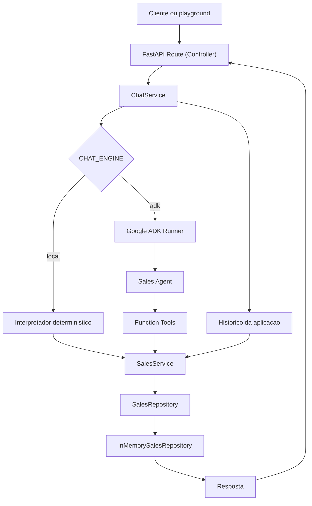

# Cerebro da Lu

API REST conversacional para um Agente de Vendas Inteligente, desenvolvida com
FastAPI e Google ADK. A aplicacao gerencia carrinho por sessao, realiza checkout
simulado via PIX e consulta o status de pedidos.

O projeto inclui um playground web em `http://localhost:8000` para demonstrar o
fluxo completo e inspecionar request, response, status HTTP e tempo de resposta.
O frontend usa o endpoint real e nao simula resultados.

## Objetivo

Atender ao contrato do desafio tecnico:

- `POST /api/v1/chat`
- Request com `session_id` e `message`
- Response com `session_id` e `response`
- Carrinho e historico persistentes em memoria por `session_id`
- Checkout PIX com ID unico e limpeza do carrinho
- Status de pedido entre `Processando` e `Enviado`
- Agente Google ADK com function tools

## Tecnologias

- Python 3.11+
- FastAPI
- Pydantic
- Google ADK
- Google Gen AI SDK
- Uvicorn
- Docker e Docker Compose
- HTML, CSS e JavaScript sem dependencias de frontend
- `unittest` e FastAPI `TestClient`

## Arquitetura

A implementacao segue separacao por responsabilidade sem adicionar camadas
cerimoniais:



### Responsabilidades

| Camada | Responsabilidade |
| --- | --- |
| FastAPI | Contrato HTTP, validacao, OpenAPI e erros |
| ChatService | Historico, selecao de engine e fallback |
| AdkRuntime | Runner, sessoes, contexto e timeout do ADK |
| Sales Agent | Instrucao do LLM e escolha de tools |
| Tools | Interface de function calling e observabilidade |
| SalesService | Regras de carrinho, pedido, PIX e historico |
| SalesRepository | Contrato de persistencia |
| InMemorySalesRepository | Dados thread-safe em memoria |
| Interpreter | Engine local deterministica para desenvolvimento |

## Estrutura

```text
src/cerebro_lu/
  adk_agent/
    agent.py           Definicao do Sales Agent
  static/
    index.html         Playground web
    styles.css         Interface responsiva
    app.js             Integracao com a API
  adk_runtime.py       Runner, sessoes e timeout do ADK
  chat_service.py      Orquestracao e historico
  config.py            Configuracao por ambiente
  interpreter.py       Engine local deterministica
  logging_config.py    Logging estruturado em JSON
  main.py              FastAPI, rotas, middleware e erros
  models.py            Modelos e retornos tipados
  repository.py        Interface e repository em memoria
  schemas.py           Schemas HTTP
  services.py          Regras de negocio
  store.py             Compatibilidade com a estrutura anterior
  tools.py             Function tools do Google ADK
tests/
  test_adk_contract.py
  test_api.py
  test_chat_service.py
  test_config_logging.py
  test_interpreter.py
  test_repository.py
  test_services.py
  test_tools.py
```

## Fluxo do agente

1. O cliente envia `session_id` e `message`.
2. O FastAPI valida e normaliza o payload.
3. O `ChatService` grava a mensagem do usuario.
4. Em modo `adk`, o `AdkRuntime` reutiliza a mesma sessao do Runner.
5. O agente interpreta a mensagem e chama uma function tool quando necessario.
6. A tool mede sua duracao e delega ao `SalesService`.
7. O service aplica a regra e acessa o repository.
8. O `ChatService` grava a resposta do assistente.
9. A API retorna somente `session_id` e `response`.

O `InMemorySessionService` do ADK mantem os eventos do Runner e os fornece ao
agente nos turnos seguintes. Em paralelo, o historico da aplicacao armazena
todas as mensagens de usuario e assistente de forma independente da engine.

## Function tools

| Tool | Funcao |
| --- | --- |
| `add_product` | Adiciona quantidade positiva de qualquer produto |
| `remove_product` | Remove um produto existente |
| `clear_cart` | Limpa o carrinho da sessao |
| `get_cart` | Retorna o estado atual do carrinho |
| `checkout_pix` | Cria pedido, gera PIX e limpa o carrinho |
| `get_order_status` | Consulta um pedido existente |

As tools nao contem regra de negocio. Elas preservam assinaturas simples para o
function calling e delegam ao `SalesService`.

## Configuracao

Copie o exemplo antes de executar:

```bash
cp .env.example .env
```

No PowerShell:

```powershell
Copy-Item .env.example .env
```

Variaveis disponiveis:

| Variavel | Padrao | Uso |
| --- | --- | --- |
| `CHAT_ENGINE` | `local` | `local` ou `adk` |
| `GOOGLE_API_KEY` | vazio | Obrigatoria para chamadas reais ao ADK |
| `ADK_MODEL` | `gemini-2.5-flash` | Modelo do agente |
| `ADK_TIMEOUT_SECONDS` | `30` | Timeout por turno do ADK |
| `LOG_LEVEL` | `INFO` | Nivel do logging estruturado |

Nunca envie `.env` ou chaves de API para o repositorio.

## Execucao local

### Windows PowerShell

```powershell
python -m venv .venv
.\.venv\Scripts\python.exe -m pip install -r requirements.txt
.\.venv\Scripts\python.exe -m uvicorn cerebro_lu.main:app --reload --app-dir src
```

### Linux ou macOS

```bash
python -m venv .venv
source .venv/bin/activate
pip install -r requirements.txt
uvicorn cerebro_lu.main:app --reload --app-dir src
```

URLs:

- Playground: `http://localhost:8000`
- Swagger UI: `http://localhost:8000/docs`
- OpenAPI: `http://localhost:8000/openapi.json`
- Healthcheck: `http://localhost:8000/health`

## Docker

```bash
docker compose up --build
```

O container:

- usa imagem `python:3.12-slim`;
- instala dependencias em layer separada;
- executa como usuario sem privilegios;
- possui healthcheck;
- recebe configuracoes apenas por variaveis de ambiente.

Para executar testes no container:

```bash
docker compose run --rm api python -m unittest discover -s tests
```

## Uso da API

### cURL

```bash
curl -X POST http://localhost:8000/api/v1/chat \
  -H "Content-Type: application/json" \
  -d '{"session_id":"user-session-12345","message":"Adicione 2 tenis de corrida ao carrinho."}'
```

### HTTP

```http
POST /api/v1/chat HTTP/1.1
Host: localhost:8000
Content-Type: application/json

{
  "session_id": "user-session-12345",
  "message": "Adicione 2 tenis de corrida ao carrinho."
}
```

Resposta:

```json
{
  "session_id": "user-session-12345",
  "response": "Perfeito! Adicionei 2 tenis de corrida ao seu carrinho. Seu carrinho agora tem 2 itens."
}
```

Erro de validacao:

```json
{
  "error": {
    "code": "validation_error",
    "message": "Payload invalido."
  }
}
```

## Testes

No PowerShell:

```powershell
$env:PYTHONPATH="src"
.\.venv\Scripts\python.exe -m unittest discover -s tests -v
```

No Linux ou macOS:

```bash
PYTHONPATH=src python -m unittest discover -s tests -v
```

A suite cobre:

- contrato e erros da API;
- isolamento de sessao;
- carrinho, remocao e limpeza;
- checkout, PIX e pedidos;
- repository e atomicidade;
- function tools;
- historico local e ADK;
- reutilizacao de sessao no Runner;
- fallback do ADK;
- configuracao e logging estruturado;
- frontend e arquivos estaticos.

## Observabilidade

Os logs sao JSON, um evento por linha. Sao medidos:

- tempo total da requisicao;
- tempo do chat;
- tempo do turno ADK;
- tempo de cada function tool;
- checkout e ID do pedido;
- consulta e pedido nao encontrado;
- fallback e erros internos.

Mensagens, codigo PIX e API keys nao sao incluidos nos logs. Toda resposta HTTP
inclui `X-Process-Time-Ms`.

## Seguranca e validacao

- `session_id` aceita apenas caracteres seguros e possui limite de 128.
- `message` possui limite de 2.000 caracteres.
- Produto vazio, quantidade zero, negativa ou excessiva sao rejeitados.
- Erros internos retornam mensagem generica, sem stacktrace.
- JSON invalido e payload invalido possuem respostas estaveis.
- Chaves permanecem apenas em variaveis de ambiente.

## Trade-offs

- Memoria foi mantida porque e requisito suficiente para o desafio.
- O parser local nao pretende substituir o LLM; ele garante execucao offline e
  testes deterministas.
- Status aleatorio foi preservado por ser regra explicita do desafio.
- O repository usa operacao atomica de checkout para evitar perda de itens em
  chamadas concorrentes.
- Nao foi adicionado catalogo de produtos: o agente aceita qualquer produto
  informado pelo usuario, conforme a natureza conversacional da proposta.

## Limitacoes

- Reiniciar o processo remove sessoes, historico e pedidos.
- Multiplas replicas nao compartilham estado em memoria.
- O modo ADK depende de rede, credencial valida e disponibilidade do provedor.
- O fallback local reconhece um conjunto controlado de intencoes em portugues.
- PIX, pedido e status sao simulados e nao representam transacoes reais.

## Escalabilidade

O contrato `SalesRepository` permite substituir a memoria sem alterar tools,
agente, API ou regras. Uma evolucao para producao pode usar:

- Redis para carrinho e sessoes com TTL;
- PostgreSQL para pedidos e auditoria;
- MongoDB para historico documental, se houver justificativa;
- idempotency key no checkout;
- autenticacao e autorizacao por usuario;
- tracing distribuido e metricas Prometheus;
- fila para processamento assincrono de pedidos.

Essas evolucoes nao foram adicionadas porque estariam alem do escopo do desafio.
